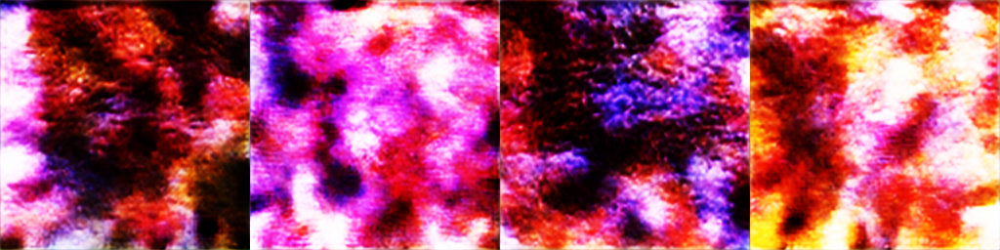
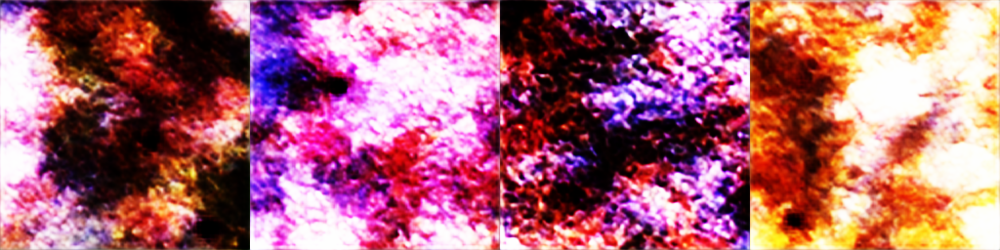
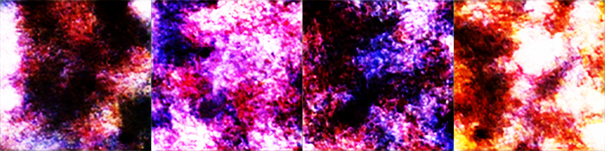

# Dual Text-Conditioning Diffusion on CUB-200

From-scratch **text-to-image latent diffusion** for fine-grained bird generation on [CUB-200-2011](https://www.vision.caltech.edu/datasets/cub_200_2011/) (256×256).

**Goal:** Train a text-to-image generator from scratch on CUB bird captions, and measure whether **combining two ways of reading the text** beats either pathway alone.

No Hugging Face Diffusers. No pretrained Stable Diffusion / LDM weights. The only pretrained module is a **frozen CLIP ViT-B/32 text encoder**.

## Models A / B / C

Same UNet architecture and **identical parameter count (81.13M)**. Only the CLIP text pathway changes:

| Model | Global (pooled CLIP → AdaGN) | Local (tokens → cross-attn) | Role |
| --- | --- | --- | --- |
| **A** | off | on | LDM-style baseline |
| **B** | on | off | Global-only ablation |
| **C** | on | on | Main model (dual conditioning) |

```text
Caption
   │
   ▼
Frozen CLIP ViT-B/32
   │
   ├──────────────► pooled embedding ──► AdaGN     [B, C]
   │
   └──────────────► token sequence ────► cross-attn [A, C]
                          │
                          ▼
              UNet εθ(z_t, t, text) on 64×64×4 latents
                          │
                          ▼
                    VAE decoder → 256×256 image
```

At inference, input is **text only** (random noise + caption → image). Images are used only during training.

## Results (summary)

Evaluated at 256×256 with guidance `w=3.0`, `n=1000` (see `results/`):

| Model | Steps | FID ↓ | CLIP aligned ↑ | CLIP swapped |
| --- | ---: | ---: | ---: | ---: |
| A | 400k | 55.36 | 0.292 | 0.278 |
| B | 500k | 58.03 | 0.272 | 0.279 |
| C | 500k | **51.16** | **0.306** | 0.295 |

- **FID:** realism / closeness to real CUB distribution (lower better)
- **CLIP aligned:** similarity of generated image to the intended caption (higher better)
- **CLIP swapped:** similarity to an attribute-swapped caption; aligned − swapped reflects binding quality

## Google Drive (checkpoints & full artifacts)

Large files are **not** in this GitHub repo (checkpoints are ~1GB each). Download final weights, caches, and full run folders from Drive:

**Drive link:** https://drive.google.com/drive/folders/1keGBlN7BsLo71awv_KT4BoZQ4akhCkiu

Expected Drive contents:

| Path | What it is |
| --- | --- |
| `runs/vae/vae_ema.pt` | Final VAE EMA weights + `latent_scale.json` |
| `runs/unet_A/unet_ema.pt`, `unet_last.pt` | UNet A final (400k steps) |
| `runs/unet_B/unet_ema.pt`, `unet_last.pt` | UNet B final (500k steps) |
| `runs/unet_C/unet_ema.pt`, `unet_last.pt` | UNet C final (500k steps) |
| `runs/*/eval_*` | FID / CLIP eval outputs |
| `cache/latents`, `cache/clip` | Precomputed training caches (optional) |
| `data/cub/...` | CUB images + Reed captions (or download separately) |

After download, place folders so paths match the commands below (`runs/`, `cache/`, `data/`).

## Sample outputs

| A | B | C |
| --- | --- | --- |
|  |  |  |

More grids: `samples/presentation/`.

## Repo layout

```text
configs/          # vae, unet_A/B/C, eval
src/              # VAE, UNet, diffusion, CLIP conditioning, data
scripts/          # train, cache, sample, eval, download
docs/             # project writeups
results/          # saved metric JSON from final evals
samples/          # qualitative demos (small PNGs only)
requirements.txt
```

## Setup

```bash
python -m venv .venv
source .venv/bin/activate          # Windows: .venv\Scripts\activate
pip install -r requirements.txt
```

Use a **CUDA** PyTorch build for training. CPU is fine for import/shape checks.

```bash
python scripts/check_shapes.py    # verifies VAE/UNet shapes; A/B/C params match
```

Device policy: `cuda` if available, else `cpu` (not `mps`).

## Data

```bash
python scripts/download_cub.py --data_root data/cub
```

Expected layout:

```text
data/cub/CUB_200_2011/images/...
data/cub/CUB_200_2011/images.txt
data/cub/CUB_200_2011/train_test_split.txt
data/cub/CUB_200_2011/bounding_boxes.txt
data/cub/text/...          # Reed captions, 10 lines per image
```

## Training order (RTX 4090)

Do not skip the VAE latent-scale step. Diffusion uses `z = μ / σ` from your VAE eval — never Stable Diffusion’s `0.18215`.

```bash
# 0) memory / throughput
python scripts/bench_4090.py --config configs/unet_C.yaml --data_root data/cub/CUB_200_2011

# 1) VAE
python scripts/train_vae.py --config configs/vae.yaml --data_root data/cub/CUB_200_2011 --out_dir runs/vae
python scripts/eval_vae.py  --config configs/vae.yaml --data_root data/cub/CUB_200_2011 --ckpt runs/vae/vae_ema.pt --out_dir runs/vae

# 2) caches (rebuild if you retrain the VAE)
python scripts/cache_latents.py --config configs/vae.yaml --data_root data/cub/CUB_200_2011 --ckpt runs/vae/vae_ema.pt --out_dir cache/latents
python scripts/cache_clip.py    --config configs/default.yaml --data_root data/cub/CUB_200_2011 --out_dir cache/clip

# 3) UNets (C main, then matched A/B)
python scripts/train_unet.py --config configs/unet_C.yaml --data_root data/cub/CUB_200_2011 \
  --vae_ckpt runs/vae/vae_ema.pt --latent_cache cache/latents --clip_cache cache/clip --out_dir runs/unet_C
python scripts/train_unet.py --config configs/unet_A.yaml --data_root data/cub/CUB_200_2011 \
  --vae_ckpt runs/vae/vae_ema.pt --latent_cache cache/latents --clip_cache cache/clip --out_dir runs/unet_A
python scripts/train_unet.py --config configs/unet_B.yaml --data_root data/cub/CUB_200_2011 \
  --vae_ckpt runs/vae/vae_ema.pt --latent_cache cache/latents --clip_cache cache/clip --out_dir runs/unet_B

# 4) sample + metrics
python scripts/sample.py --config configs/unet_C.yaml --ckpt runs/unet_C/unet_ema.pt \
  --vae_ckpt runs/vae/vae_ema.pt --prompt "a small bird with a red crown and a black throat" --out samples/demo.png
python scripts/eval_t2i.py --config configs/eval.yaml --unet_config configs/unet_C.yaml \
  --ckpt runs/unet_C/unet_ema.pt --vae_ckpt runs/vae/vae_ema.pt \
  --data_root data/cub/CUB_200_2011 --out_dir runs/unet_C/eval
```

Final trained budgets used in this project: **A = 400k steps**, **B = C = 500k steps**.

## Citation / context

Course project (Deep Learning). Backbone idea follows latent diffusion (Rombach et al.); dual text fusion is studied as a controlled A/B/C ablation on CUB with matched compute — not claimed as a new invention of LDM itself.
